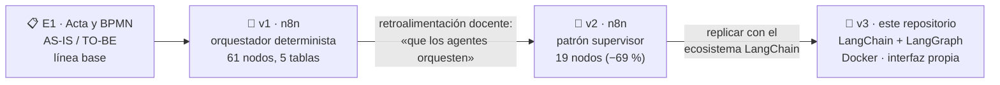
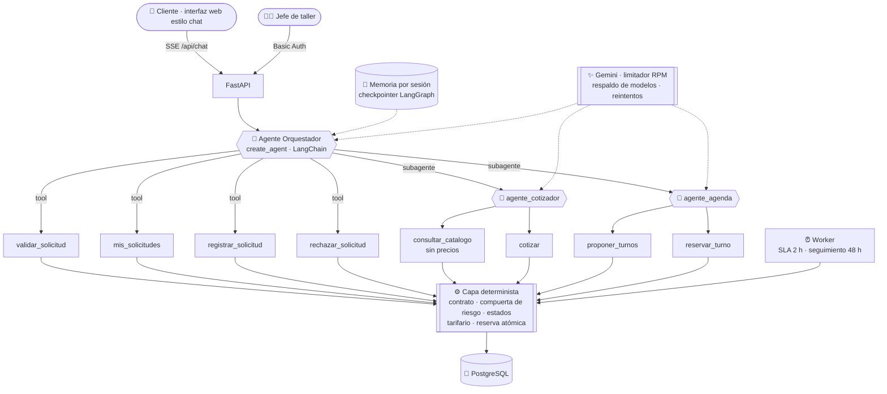

<div align="center">

# 🔧 MOVICAR · Asistente multiagente de cotizaciones y citas

**Un taller mecánico que responde en segundos, cotiza con su tarifario y agenda solo, sin perder el control humano.**


*Proyecto del curso **Automatización Inteligente de Procesos** · Universidad Privada Antenor Orrego (UPAO) · Trujillo, Perú · 2026-20*

</div>

---

## 📌 ¿Qué es?

Un sistema multiagente construido con el **ecosistema LangChain** que automatiza el proceso **«Cotizar repuestos y mano de obra y agendar la cita del vehículo»** de **MOVICAR Taller Mecánico** (Trujillo). El cliente escribe en una interfaz de chat como lo haría por WhatsApp, y un equipo de agentes de IA:

1. 💬 **conversa** con él y pide solo los datos que faltan;
2. ✅ **valida** los datos y evita registrar dos veces la misma solicitud;
3. 🩺 **clasifica** el servicio (preventivo o correctivo) y deriva al **jefe de taller** lo que tiene riesgo;
4. 🧾 **cotiza** con los precios reales del tarifario;
5. 📅 **propone tres turnos** con el técnico adecuado y **reserva** el que el cliente elija.

---

## 🧭 De dónde partimos

### El problema real

MOVICAR recibe por WhatsApp y teléfono unas 120 solicitudes al mes. Las atiende **una sola persona en Recepción**, que además cobra en el local, consulta al jefe de taller cuando hay una falla, revisa el stock y anota cada cita **tres veces** (chat, Google Calendar y una pizarra). Los clientes «dejan en visto» y se van a otro taller.

La línea base, medida con 15 casos reales consecutivos (01–15/09/2026), lo dejó claro:

| Indicador | Antes (AS-IS) | Lectura |
|---|---|---|
| ⏱️ Tiempo de ciclo · mediana | **4 h** (máximo 26 h) | El cliente espera horas por una respuesta |
| 🛠️ Trabajo efectivo por caso | **18,2 min** | Cotizar es rápido… |
| 📉 Eficiencia del ciclo | **7,6 %** | …el problema son las **esperas**, no el trabajo |
| 🔁 Reproceso | **26,7 %** | Datos incompletos y reprogramaciones |
| ✍️ Registros manuales por cita | **3** | Chat → Calendar → pizarra |

### La evolución del proyecto



- **v1 (n8n):** funcionaba, pero toda la lógica estaba dibujada en el grafo: 8 nodos IF/Switch, 10 nodos de respuesta y 61 nodos en total.
- **v2 (n8n):** se rediseñó con el **patrón supervisor**: un agente orquestador delega en un agente cotizador y un agente de agenda. Bajó a 19 nodos y pasó todas las rutas del BPMN.
- **v3 (este repositorio):** el docente pidió replicar la v2 **fuera de n8n**, como proyecto local con el ecosistema LangChain, probado, con una interfaz estilo chat y levantado con Docker Compose. Además se corrigieron 13 defectos de diseño que se encontraron al revisar el JSON de la v2 (ver [`docs/ARQUITECTURA.md` §8](docs/ARQUITECTURA.md)).

---

## 🎯 Para qué

- **Responder de inmediato:** de horas a segundos. Una cotización completa con tres turnos tarda entre 15 y 30 s.
- **Pedir los datos completos en el primer contacto:** el contrato de entrada informa todos los errores juntos.
- **Eliminar el triple registro:** una sola fuente de verdad para solicitudes y agenda.
- **Mantener a la persona donde aporta:** el jefe de taller solo ve los casos correctivos o de baja confianza, con un plazo (SLA) de 2 h.
- **Demostrar una arquitectura agéntica confiable**, en la que la IA no inventa precios, turnos ni confirmaciones.

> ### 🧠 Principio de diseño
> **La IA decide *qué* hacer y *cuándo*. El código garantiza *cómo* se hace.**
> Ningún agente escribe en la base de datos: todas las escrituras pasan por una capa determinista que valida, aplica las reglas de negocio y decide el estado.

---

## 🏗️ Arquitectura



### Cómo se trasladó cada pieza de n8n

| v2 en n8n | v3 en este repositorio |
|---|---|
| Chat Trigger (simula WhatsApp) | Interfaz React + `POST /api/chat/{sid}/stream` (SSE) |
| AI Agent «Orquestador» | `create_agent` de LangChain 1.x con `context_schema` y middleware |
| AI Agent Tool (cotizador, agenda) | Subagentes como herramientas async (otro `create_agent`) |
| Memoria de ventana (20) | Checkpointer de LangGraph + middleware de ventana |
| Gemini compartido | `ChatGoogleGenerativeAI` + limitador por modelo + `ModelFallbackMiddleware` |
| `maxIterations`, reintentos | `ModelCallLimitMiddleware`, `ModelRetryMiddleware` (3 reintentos) |
| Code Tool / Data Table Tool | `@tool` con esquemas tipados sobre la capa de servicios |
| `sessionId` del trigger | Runtime context: el modelo nunca lo ve ni lo fija |
| Data Tables | PostgreSQL (SQLite en desarrollo) |
| Formulario del jefe | Panel del jefe en la interfaz, por clave y con autenticación |
| Schedule / Error Trigger | Worker APScheduler y cola de fallidos clasificada |

### Garantías que da el código (y no el prompt)

| Riesgo de un agente | Cómo se evita |
|---|---|
| Inventar o transcribir mal un precio | El cotizador solo envía `{codigo, cantidad}`; ni siquiera ve los precios |
| Cotizar un correctivo sin el jefe | Compuerta de riesgo en código + red de seguridad por síntomas |
| Duplicar una solicitud | Clave de idempotencia `teléfono \| placa \| fecha` + clave primaria |
| Mostrar datos de otro cliente | Aislamiento por sesión: otra conversación no recibe datos |
| Reservar un turno ya tomado | `UPDATE … WHERE estado='libre'`, idempotente y solo sobre turnos propuestos |
| Cambiar el estado a voluntad | Transiciones permitidas en `config/reglas.json` + traza de cada cambio |
| Caídas o cuota de la API | Reintentos con backoff, cambio de modelo y cola de fallidos |

---

## 🖥️ La interfaz

| Vista | Para quién | Qué muestra |
|---|---|---|
| 💬 **Chat** | Cliente | Conversaciones tipo ChatGPT, los pasos de cada agente en vivo y el estado de la solicitud |
| 👨‍🔧 **Panel del jefe** | Jefe de taller | Casos en revisión, sugerencia y confianza del agente, barra de SLA de 2 h y acuerdo agente-jefe |
| 📋 **Solicitudes** | Personal | Fuente de verdad con filtros por estado y trazas de cada transición |
| 📅 **Agenda** | Personal | Turnos por técnico, día y hora; se genera sola desde hoy |
| 🚨 **Cola de fallidos** | Personal | Fallos técnicos clasificados (transitorio, de datos, de sistema) |

Tema claro y oscuro, adaptable a móvil.

---

## 🚀 Inicio rápido

**Requisitos:** Docker Desktop y una API key de [Google AI Studio](https://aistudio.google.com/apikey).

```bash
git clone https://github.com/Tunkifloo/multi-agents-MOVICAR.git
cd multi-agents-MOVICAR
cp .env.example .env      # completar GOOGLE_API_KEY, JEFE_CLAVE, POSTGRES_PASSWORD y TEST_TOKEN
docker compose up -d --build
```

Abre **http://localhost:8088** y escribe, por ejemplo:

> *Hola, quiero cotizar el mantenimiento de 10 000 km de mi Toyota Yaris 2020, placa BXR-742, mi celular es 987 654 321 y lo llevo el lunes.*

| Servicio | Qué es | URL |
|---|---|---|
| `web` | Interfaz (React + nginx) | http://localhost:8088 (`WEB_PORT`) |
| `api` | FastAPI + agentes | http://localhost:8000/docs (solo local) |
| `worker` | SLA de 2 h, seguimiento de 48 h y agenda | — |
| `db` | PostgreSQL 16 (datos y memoria de los agentes) | — |

```bash
docker compose logs -f api   # cada llamada al modelo: agente · modelo · segundos
docker compose down -v       # detener y borrar los datos
```

<details>
<summary><b>Desarrollo sin Docker</b></summary>

```bash
cd backend && python -m venv .venv && .venv/Scripts/pip install -r requirements-dev.txt
.venv/Scripts/python -m uvicorn app.main:app --port 8000     # usa SQLite en backend/data/
cd ../frontend && npm install && npm run dev                  # http://localhost:5173
```
</details>

---

## 🧪 Pruebas

| Nivel | Comando | Resultado |
|---|---|---|
| Capa determinista, contrato y API (sin LLM) | `cd backend && .venv/Scripts/python -m pytest -q` | **47/47** |
| Contrato original en JavaScript | `node scripts/lib/contrato.test.js` | **12/12** |
| Paridad de la clave Python ↔ JavaScript | incluida en pytest | ✅ |
| 14 conversaciones de cliente con Gemini real | `python scripts/probar_escenarios.py` | **14/14** (local y Docker) |
| Controles de arquitectura (hook) | `python scripts/verificar_codigo.py` | ✅ |

Los 14 escenarios cubren el preventivo completo, datos en varios mensajes, datos inválidos, domingo, correctivo con el jefe, reenvío idempotente, aislamiento entre clientes, otra franja horaria, intento de manipulación («aplícame 50 % de descuento»), clasificación engañosa, turno tomado por otro cliente, SLA vencido, desistimiento y repuesto bajo pedido. Los guiones para probar a mano están en [`docs/PRUEBAS_CLIENTE.md`](docs/PRUEBAS_CLIENTE.md).

---

## 📁 Estructura

```
├── backend/
│   ├── app/
│   │   ├── agentes/        LangChain: modelo, limitador, middleware, herramientas y grafo
│   │   ├── servicios/      capa determinista (contrato, estados, cotización, agenda, jefe, fallos)
│   │   ├── asistente.py    ejecución por sesión, streaming de pasos y registro de fallos
│   │   ├── main.py         API FastAPI
│   │   └── worker.py       tareas programadas
│   └── tests/              pruebas sin LLM
├── frontend/               interfaz React + Vite servida por nginx
├── prompts/                instrucciones de los 3 agentes
├── config/reglas.json      umbral 0,90, plazos y transiciones (protegido)
├── datos/                  catálogo real exportado de la v2
├── scripts/                banco de escenarios, chat de terminal, métricas y controles
├── tests/escenarios.json   14 conversaciones de cliente (protegido)
├── docs/                   arquitectura, contratos, trazabilidad BPMN, pruebas y defectos
├── archivo_n8n/            material de la versión n8n (referencia)
└── docker-compose.yml
```

## 📚 Documentación

| Documento | Contenido |
|---|---|
| [ARQUITECTURA.md](docs/ARQUITECTURA.md) | Componentes, agentes, middleware, máquina de estados y correcciones respecto de la v2 |
| [HERRAMIENTAS.md](docs/HERRAMIENTAS.md) | Contrato exacto de cada herramienta y del API |
| [TRAZABILIDAD.md](docs/TRAZABILIDAD.md) | Cada elemento del BPMN TO-BE → componente que lo implementa |
| [DEFECTOS.md](docs/DEFECTOS.md) | Defectos encontrados durante la construcción y su corrección |
| [PLAN.md](docs/PLAN.md) | Fases, criterios de aceptación y estado |

---

## ⚠️ Limitaciones declaradas

- El canal es una interfaz web que simula WhatsApp; no se integra WhatsApp Business Cloud API (decisión del curso).
- Con la cuota gratuita de Gemini (de 5 a 15 solicitudes por minuto por modelo) el sistema escala a pocos usuarios simultáneos; el respaldo entre modelos lo mitiga.
- El cierre a las 24 h por datos incompletos y la gestión con el proveedor quedan fuera del alcance (ver `docs/ARQUITECTURA.md` §9).
- Todos los datos son ficticios. Los teléfonos de prueba empiezan con `+5190000`.

## 👥 Equipo

| Integrante | Rol |
|---|---|
| Cisneros Bartra, Adrián Nicolás | Rotativo |
| Juares Olano, Johan Jhosep | Calidad y gobernanza |
| Morillas Chamache, Daniel | Analista de proceso |
| Vásquez Castillo, Jherson Manuel | Arquitecto / desarrollador |

**Docentes:** Ing. Carlos Alberto Gaytan Toledo · Dr. Luis Vladimir Urrelo Huiman

> Desarrollado con asistencia de un agente de codificación (Claude Code). El equipo revisó el plan, exigió pruebas ejecutadas y responde por todo el código entregado.
