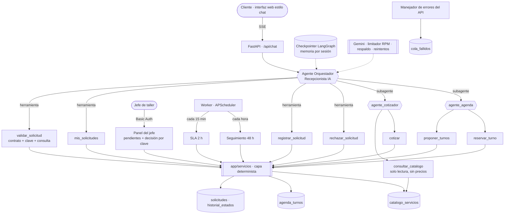
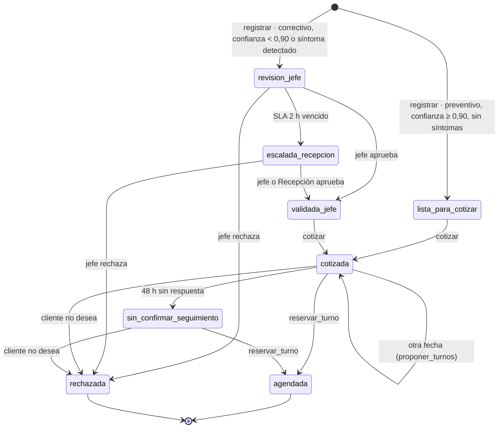

# MOVICAR · Arquitectura de la solución (v3 · LangChain)

Proceso automatizado: **«Cotizar repuestos y mano de obra y agendar la cita del vehículo»** de MOVICAR Taller Mecánico (Trujillo).
Plataforma: **LangChain 1.x + LangGraph · Google Gemini · FastAPI · PostgreSQL · React · Docker Compose**.

La v3 replica el patrón de la v2 de n8n (un agente supervisor que delega en subagentes) y corrige los defectos que encontramos al revisar el JSON de la v2 (sección 8). La regla de diseño es una sola:

> **La IA decide qué hacer y cuándo. El código garantiza cómo se hace.**
> Ningún agente escribe directamente en la base de datos. Todas las escrituras pasan por la capa determinista (`backend/app/servicios`), que valida, aplica las reglas de negocio y decide el estado.

---

## 1. Vista general



**Leyenda:** `{{ }}` = agente de IA (`create_agent`) · `[ ]` = herramienta (`@tool`) · `[[ ]]` = código determinista · `[( )]` = tabla.

---

## 2. Componentes y servicios (Docker Compose)

| Servicio | Tecnología | Responsabilidad |
|---|---|---|
| `web` | React 19 + Vite, servido por nginx | Interfaz estilo chat (cliente) y vistas del personal: panel del jefe, solicitudes, agenda y cola de fallidos. nginx hace de proxy a `/api`, sin buffer para SSE |
| `api` | FastAPI + LangChain 1.x + LangGraph | Canal del cliente, agentes, capa determinista, vistas del personal y utilidad de pruebas |
| `worker` | APScheduler (misma imagen que `api`) | SLA de 2 h (cada 15 min), seguimiento de 48 h (cada hora) y agenda de los próximos 21 días (diaria) |
| `db` | PostgreSQL 16 | Tablas de negocio y checkpoints de LangGraph (memoria de las conversaciones) |

En desarrollo, `api` usa SQLite (`backend/data/`) y la interfaz corre con `npm run dev`.

---

## 3. Agentes (LangChain `create_agent`)

| Agente | Modelo (por defecto) | Qué decide (probabilístico) | Qué NO decide (lo hace el código) |
|---|---|---|---|
| **Orquestador** (Recepcionista IA) | `gemini-3.5-flash-lite` | Qué datos faltan, cómo interpretar fechas relativas, la clasificación preventivo/correctivo y su confianza, qué herramienta llamar y cómo responder | Validez de los datos, clave, estado, si el caso va al jefe, precios, turnos |
| **agente_cotizador** | `gemini-3.1-flash-lite` | Qué códigos del catálogo corresponden al síntoma o al kilometraje, y sus cantidades | Precios, stock, subtotales, total, repuestos bajo pedido |
| **agente_agenda** | `gemini-3.1-flash-lite` | Traducir la preferencia del cliente («el sábado en la tarde») a fecha y franja, e identificar la opción elegida | Qué turnos existen y están libres, la especialidad, la reserva |

**Subagente como herramienta.** `agente_cotizador` y `agente_agenda` son herramientas async del orquestador que invocan otro `create_agent` (igual que el *AI Agent Tool* de n8n). Mejora respecto de la v2: lo que vuelve al orquestador es el **resultado de la herramienta determinista** (precios, turnos, `texto_cliente`), no una transcripción del LLM. Las herramientas finales (`cotizar`, `proponer_turnos`, `reservar_turno`) son `return_direct`, así el subagente no gasta otra llamada al modelo.

**Middleware de LangChain** (de afuera hacia adentro):

| Middleware | Para qué |
|---|---|
| `PromptYVentana` (propio) | Prompt de sistema con la fecha y un calendario de 14 días de Lima en cada llamada; recorta a 20 mensajes lo que ve el modelo, siempre desde un mensaje del cliente |
| `ModelRetryMiddleware` | 3 reintentos con backoff (BPMN: «Fallo de API tras 3 reintentos») |
| `ModelFallbackMiddleware` | Si un modelo devuelve 429/503 o su cuota local está llena, pasa al siguiente modelo de inmediato |
| `RegistroLLM` (propio) | Log por intento: agente · modelo efectivo · segundos · error |
| `ModelCallLimitMiddleware` | Tope de llamadas por turno (15 en el orquestador, 6 en los subagentes), equivale a `maxIterations` |

**Contexto de ejecución.** `Contexto(session_id, emitir)` es el *runtime context* de LangGraph: las herramientas leen el `session_id` de ahí, nunca de los argumentos del modelo (equivale a inyectarlo desde el Chat Trigger). `emitir` envía a la interfaz los pasos de cada agente.

**Cuotas de Gemini (plan gratuito).** Cada modelo tiene su propia cuota por minuto (medida: `gemini-3.5-flash` 5 RPM; `gemini-3.5-flash-lite` y `gemini-3.1-flash-lite` 15 RPM). `LimitadorRPM` lleva una ventana deslizante de 60 s por modelo y, si habría que esperar más de 4 s, lanza `CuotaLocalAgotada` para que el respaldo use otro modelo. Gemini 2.5 Flash, que usaba la v2, ya no está disponible para cuentas nuevas.

---

## 4. Herramientas y contratos

Contratos exactos en `docs/HERRAMIENTAS.md`. Resumen:

| Herramienta | Llamada por | Entrada (la rellena la IA) | Escribe |
|---|---|---|---|
| `validar_solicitud` | Orquestador | telefono, placa, vehiculo, kilometraje, fecha_deseada, descripcion_falla | Nada (devuelve también si la clave ya existe) |
| `mis_solicitudes` | Orquestador | — (usa el `session_id` del contexto) | Nada |
| `registrar_solicitud` | Orquestador | datos crudos + tipo_servicio_agente + confianza + prioridad + especialidad sugeridas | `solicitudes` |
| `rechazar_solicitud` | Orquestador | clave | `solicitudes` |
| `consultar_catalogo` | Cotizador | — | Nada (sin precio ni stock) |
| `cotizar` | Cotizador | clave, items `[{codigo, cantidad}]` | `solicitudes` |
| `proponer_turnos` | Agenda | clave, fecha_desde, franja (`manana`/`tarde`/`cualquiera`) | `solicitudes` |
| `reservar_turno` | Agenda | clave, opcion (1–3) o turno_id | `agenda_turnos`, `solicitudes` |

**Regla de oro:** ninguna herramienta expone al modelo `estado`, `session_id`, precio, stock ni total, y el paquete `app/agentes` no importa la base de datos. `scripts/verificar_codigo.py` lo comprueba en cada edición (hook PostToolUse).

---

## 5. Máquina de estados de una solicitud



Cada escritura valida la transición contra `config/reglas.json → transiciones` (`servicios/estados.py`) y deja una fila en `historial_estados` (actor, momento, detalle). Una transición no permitida devuelve `{ok:false, error:"transicion_invalida", estado_actual}` y no escribe nada.

**Compuerta de riesgo (en código, `servicios/solicitudes.py`):**

```text
si tipo_servicio_agente == "correctivo"
   O confianza_agente < UMBRAL_CONFIANZA (config/reglas.json)
   O la descripción contiene un síntoma (ruido, vibra, se apaga, check engine…)  ← red de seguridad nueva
    → estado = revision_jefe   (motivo_revision explica por qué)
si no
    → estado = lista_para_cotizar
```

`cotizar` solo acepta `lista_para_cotizar`, `validada_jefe` o `cotizada`: aunque el agente se salte un paso del prompt, **no puede cotizar un correctivo sin la aprobación del jefe**.

---

## 6. Datos

### 6.1 `catalogo_servicios`
`codigo` · `concepto` · `tipo` · `categoria` · `especialidad` · `precio_unitario` · `stock` · `horas` · `aplica_a`.
Semilla: **`datos/catalogo_servicios_real_v2.csv`**, exportado de la Data Table real de la v2 (10 000 km = S/ 355). `datos/catalogo_servicios.csv` (precios de referencia del colega) se conserva sin cambios porque es un elemento protegido.

### 6.2 `agenda_turnos`
`turno_id` · `fecha` · `hora` · `franja` · `mecanico` · `especialidad` · `estado` · `clave_solicitud`. Lunes a sábado, 08:00 / 11:00 / 15:00, Técnico A (general), B (motor y eléctrico) y C (frenos y suspensión). Se genera **desde la fecha de ejecución** y el worker la extiende cada día: ya no caduca.

### 6.3 `solicitudes`

| Columna | Quién la escribe |
|---|---|
| `clave`, `session_id`, datos normalizados del cliente | `registrar` (el `session_id` viene del contexto y nunca se sobrescribe) |
| `tipo_servicio_agente`, `confianza_agente`, `motivo_revision` | `registrar` |
| `tipo_servicio`, `prioridad`, `especialidad` | `registrar` (sugeridas); el jefe las corrige |
| `tipo_servicio_jefe`, `observacion_jefe`, `decidido_por` | Panel del jefe |
| `total_cotizacion`, `cotizacion_detalle`, `requiere_proveedor` | `cotizar` |
| `turnos_propuestos` (3 opciones numeradas) | `proponer_turnos` |
| `turno_confirmado` | `reservar_turno` |
| `estado`, `ts_estado` | Solo la capa determinista y el worker |

`tipo_servicio_agente` frente a `tipo_servicio_jefe` alimenta la **métrica de acuerdo agente-jefe** (bucle de calibración del umbral; panel del jefe y `scripts/metricas_acuerdo.py`).

### 6.4 Soporte
`historial_estados` (trazas) · `cola_fallidos` (`momento`, `flujo`, `ejecucion`, `clase_error`, `motivo`, `carga_original`, `intentos`) · `conversaciones` y `mensajes` (historial de la interfaz) · tablas `checkpoint*` de LangGraph (memoria de los agentes).

---

## 7. Clave de idempotencia

`clave = hash(telefono_normalizado | placa_normalizada | fecha_deseada)` con formato `MV-xxxxxxxxxxxxxxxx`. `backend/app/contrato.py` es un port 1:1 de `scripts/lib/contrato.js`; `tests/test_contrato.py` ejecuta el `.js` con Node y verifica que ambos producen la misma clave.

**Por qué no lleva `tipo_servicio`:** lo infiere el LLM y el jefe lo puede corregir; con ese campo la misma solicitud podía generar dos claves. *(Actualizar la hoja «Idempotencia» del Lab 02.)*

**Aislamiento por cliente:** si la clave existe con otro `session_id`, la consulta devuelve `{existe:true, misma_sesion:false}` sin datos, y el orquestador responde que ya hay una solicitud registrada y que el taller se comunicará al número registrado.

---

## 8. Correcciones respecto de la v2

| # | Problema en la v2 (n8n) | Corrección en la v3 |
|---|---|---|
| 1 | `calcular_cotizacion` recibía precio y stock transcritos por el LLM | `cotizar` recibe solo `codigo` y `cantidad`; el agente ni siquiera ve los precios |
| 2 | `guardar_solicitud` tomaba todos los campos, incluido el estado, de `$fromAI()` | Sin escritura libre: una función por transición y el estado lo decide el código |
| 3 | La compuerta «¿preventivo y confianza ≥ 0,90?» vivía en el prompt | La compuerta está en código, con red de seguridad por síntomas; `cotizar` rechaza estados no aprobados |
| 4 | Otra sesión con los mismos datos veía la cotización y sobrescribía `session_id` | `session_id` del contexto, fijado al crear; otra sesión no ve datos ni puede escribir |
| 5 | El reintento repetía `reservar_turno` y respondía «no se reservó» | Reserva atómica e idempotente; si el turno se ocupó, devuelve alternativas sin otra vuelta por el modelo |
| 6 | `revision_jefe` no tenía temporizador | Worker: SLA de 2 h → `escalada_recepcion` |
| 7 | El seguimiento de 48 h no estaba publicado | Worker cada hora; el orquestador maneja `sin_confirmar_seguimiento` |
| 8 | La bandeja del jefe actualizaba por placa y sin autenticación | Decisión por clave, con Basic Auth, lista de pendientes y SLA visible |
| 9 | Domingo solo en el prompt; aceptaba fechas en 2099 | El contrato rechaza domingos y fechas a más de 60 días |
| 10 | Lo desconocido se clasificaba `de_datos`; `intentos` fijo | Lo desconocido va a `de_sistema`; intentos = reintentos + 1 |
| 11 | La agenda de prueba caducaba el 17/10 | Agenda relativa a hoy, extendida por el worker |
| 12 | `tipo_servicio` en la clave | La clave usa solo datos del cliente |
| 13 | Llamadas en paralelo de Gemini daban 400 (D1) | Una herramienta por turno (prompt) y respaldo de modelos ante 429/503 |

---

## 9. Fuera de alcance (declarado)

- WhatsApp Business y Google Calendar reales: el canal es la interfaz web. El diseño solo cambia el canal (otro endpoint que llame a `asistente.responder`) y la tabla de agenda.
- Cierre automático a las 24 h por datos incompletos (BPMN TO-BE): sin fila registrada no hay qué cerrar; se propone para v4 con una tabla de borradores.
- Recordatorio al cliente a las 48 h: hoy solo cambia el estado para que Recepción haga el seguimiento.
- Confirmación con el proveedor: `requiere_proveedor=true` y el aviso en la cotización; la gestiona Recepción.
